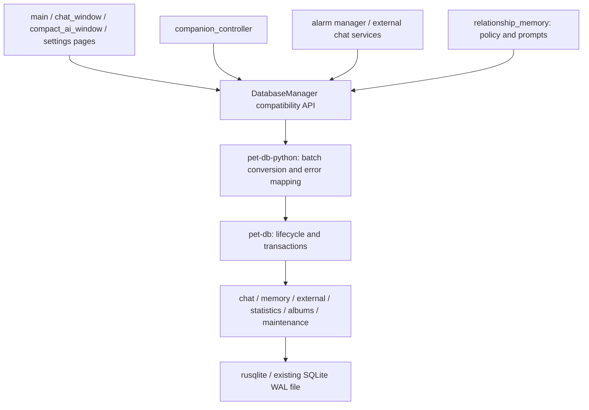

# Rust database migration

## Audit and dependency map

The migration starts from commit `caf080de900ed8357cf9ef37f31d10b7766fffcd` on a clean checkout.

`DatabaseManager` owns 11 tables, additive column upgrades and 11 indexes. The
schema has no version ledger; upgrades must remain introspection based so older
applications can reopen the same file. `relationship_memory.py` contains prompt,
profile routing and extraction policy, not SQL. `config_manager.py` stores JSON
configuration and provides `DEFAULT_USER_PROFILE_KEY`; it is not a database.

Call graph:

The chat-history worker directly uses `_conn.interrupt()` for cancellation.
Tests use `_conn.execute`, `commit`, and schema introspection. These need a native
connection facade, not removal or a second Python SQLite connection. Processes
independently construct managers; SQLite locking must serialize writers across
processes. The previous Python file lock serializes even reads and can retain an
unbounded path cache. It is replaced by SQLite transactions and busy timeout.

Existing tests cover message mutation, pagination, external context privacy,
token accounting, backgrounds, attachment cleanup and import failure atomicity.
An immutable copy of the original implementation lives only in
`tests/baselines/legacy_database.py` for differential tests and benchmarks.
Production must never fall back to it.

## Stages

1. Capture contracts and baseline; establish crates and explicit build tool.
2. Move schema, connection lifetime, transactions and legacy raw facade.
3. Move chat, groups, memory/state and external chat into domain modules.
4. Move statistics, albums, maintenance; replace Python SQL with API adapters.
5. Verify parity, concurrency, crash safety and benchmarks; integrate packaging.

Each stage is committed after its focused checks. No user database is used in
tests. The existing schema and local-time timestamp format are preserved.
