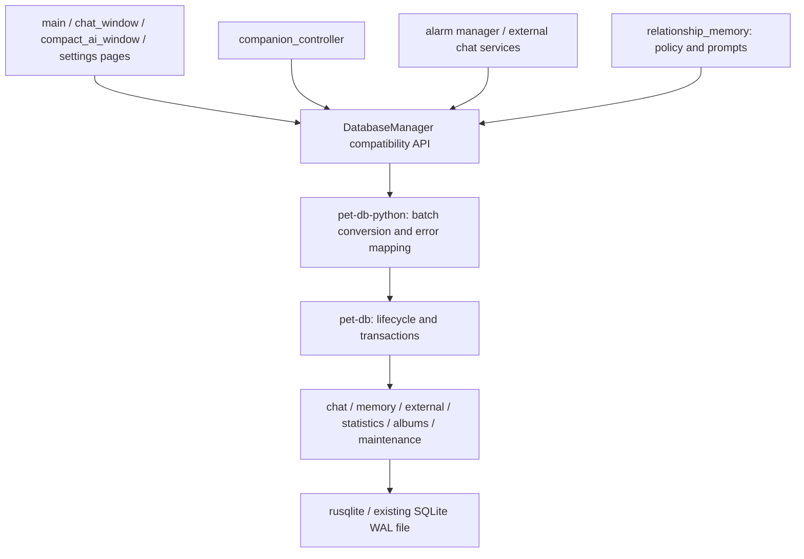

# Rust database migration

## Audit and dependency map

The migration starts from commit `caf080de900ed8357cf9ef37f31d10b7766fffcd` on a clean checkout.

`DatabaseManager` owns 11 tables, additive column upgrades and 11 indexes. The
schema has no version ledger; upgrades must remain introspection based so older
applications can reopen the same file. `relationship_memory.py` contains prompt,
profile routing and extraction policy, not SQL. `config_manager.py` stores JSON
configuration and provides `DEFAULT_USER_PROFILE_KEY`; it is not a database.

Call graph:



The chat-history worker directly uses `_conn.interrupt()` for cancellation.
Tests use `_conn.execute`, `commit`, and schema introspection. These need a native
connection facade, not removal or a second Python SQLite connection. Processes
independently construct managers; SQLite locking must serialize writers across
processes. The previous Python file lock serializes even reads and can retain an
unbounded path cache. It is replaced by SQLite transactions and busy timeout.

Existing tests cover message mutation, pagination, external context privacy,
token accounting, backgrounds, attachment cleanup and import failure atomicity.
An immutable copy of the original implementation lives only in
`tests/baselines/legacy_database.py` for differential tests and benchmarks.
Production must never fall back to it.

## Stages

1. Capture contracts and baseline; establish crates and explicit build tool.
2. Move schema, connection lifetime, transactions and legacy raw facade.
3. Move chat, groups, memory/state and external chat into domain modules.
4. Move statistics, albums, maintenance; replace Python SQL with API adapters.
5. Verify parity, concurrency, crash safety and benchmarks; integrate packaging.

Each stage is committed after its focused checks. No user database is used in
tests. The existing schema and local-time timestamp format are preserved.

## Implemented architecture

- `pet-db/src/lib.rs`: connection ownership, mutex, process identity, transaction
  boundaries and dispatch. One manager owns one connection; there are no worker
  threads, polling loops or global connection/path caches.
- `schema.rs` / `schema.sql`: the original 11 tables, column upgrades and indexes,
  in one atomic introspection-based migration. No additional table, column,
  `user_version` convention or data format is introduced by this migration.
- `chat.rs` / `history.rs` / `search.rs`: private/group CRUD, backgrounds, attachment
  metadata queries, token aggregation, filter options and literal substring
  search. Frequently read history has typed owned rows and a direct batch PyO3
  conversion path. Token scans stream in Rust rather than returning every trace.
- `memory.rs`: scoped memory deduplication, updates, deletes, relationship state,
  mood-event snapshots and relationship JSON import/export.
- `external.rs`: duplicate detection, thread summaries, unread state, privacy
  scopes, 50-message external group retention and cleanup.
- `statistics.rs` / `albums.rs`: usage sessions, daily counts, mood charts,
  heatmaps, character attribution and memory albums. Character attribution scans
  stream, with asset aliases read from the existing outfit resource.
- `maintenance.rs`: validated online snapshots, restoration into live SQLite
  connections, legacy file relocation and chunked attachment cleanup.
- `pet-db-python`: owned argument conversion, GIL detachment, batch result
  conversion and standard Python SQLite exception classes. SQLite is executed
  through rusqlite, never through a Python sqlite3 connection or callback.
- `bandori_core/database_manager.py`: original public signatures, incoming
  attachment policy, UI asset helper methods and orchestration. It contains no
  SQL. `native_database.py` loads the extension and implements the used `_conn`
  diagnostic surface on the same Rust connection.

The compatibility surface supports `execute`, positional `executemany`, cursors,
`fetchone/fetchmany/fetchall`, iteration, transaction context management,
`commit/rollback`, `total_changes`, `in_transaction`, `interrupt` and `close`.
It is not an implementation of every optional sqlite3 connection feature (for
example arbitrary Python SQL functions and custom row factories). The repository
uses none of those features. Raw diagnostic result sets are materialized; normal
application history reads use the native typed batch path. Raw transactions must
not be mixed between threads; use atomic domain methods for concurrent work.

## Transactions, concurrency and resource limits

Lock order is GIL release → per-connection Rust mutex → SQLite transaction. The
mutex and transaction are gone before constructing Python results or exceptions.
No Python callback runs with a database lock held. The independent SQLite
interrupt handle allows the chat-history worker to cancel a running query.

Writers use `BEGIN IMMEDIATE`, a 10-second SQLite busy timeout, foreign keys and
WAL. Read-modify-write state changes, event insertion, external duplicate checks,
thread updates and all bulk writes are single transactions. Read operations with
multiple statements use a consistent deferred snapshot. RAII rolls back errors;
close rolls back uncommitted diagnostic transactions. The old Python process-wide
file lock and retry wrapper are removed. The separate one-time legacy relocation
uses an OS file lock and online backup; its lock inode is retained to avoid split
locks. Ordinary database access creates no Python `.lock` file.

Each process must create its own manager. Native calls reject handles inherited
from a different process; multiprocessing tests use spawn. Statement caches are
limited to 64 entries per connection. The paginated history API keeps its existing
1–1000 limit, search uses bounded results, attachment cleanup reads 256 metadata
rows at a time, and backups copy 256 SQLite pages at a time. Explicit legacy APIs
such as `get_messages(limit=None)` and relationship export still return complete
results for compatibility; applications should use pagination for large histories.

## Data safety and recovery

All existing schemas, IDs, unique constraints, user keys, Unicode text, mood
snapshots and local-time timestamps remain readable by the frozen legacy oracle.
The migration adds only columns/indexes the previous Python version already
added. Failed schema upgrades roll back; unknown columns are retained. Rolling
back to the old binary does not require a destructive schema downgrade.

Export uses SQLite online backup into a temporary file, flushes it and atomically
publishes the snapshot. An export destination with WAL/SHM sidecars is rejected.
Import first validates integrity and required schema, snapshots the source,
upgrades and sanitizes a private staged copy, then restores with SQLite's backup
API into the existing target. It does not replace a live database inode. Other
open managers observe the change through SQLite data-version tracking. Import
sources are opened read-only; snapshots include uncheckpointed WAL data.

Malformed attachment JSON now raises an error naming the table and row and rolls
back cleanup/import. The previous implementation could replace it with an empty
list; silently discarding that evidence conflicts with the data-safety requirement.
Valid but missing/unsafe attachment references are cleaned using the existing
attachment-directory policy. Invalid token JSON remains untracked and is never
rewritten; historical Python JSON `Infinity`/`NaN` constants are tolerated while
preserving other valid usage fields.

A structurally corrupt database fails explicitly; the application does not claim
to salvage arbitrary corrupt pages. Recover into a **new path** from a verified
export using `import_chat_database(backup_path, recovered_path)`, verify it, and
keep the damaged original and sidecars for diagnosis. Stop all application
processes before switching the configured data file. Tests verify recovery of
chat, memories and affection into an isolated file without changing the corrupt
original. There is no automatic deletion or replacement of damaged user data.

## Build and release

```sh
python tools/build_db.py                  # release, current interpreter/CPU
python tools/build_db.py --debug          # development
cargo fmt --manifest-path native/pet_backend/Cargo.toml --all -- --check
cargo clippy --manifest-path native/pet_backend/Cargo.toml --workspace --all-targets --locked -- -D warnings
cargo test --manifest-path native/pet_backend/Cargo.toml --workspace --all-targets --locked
python -m pytest tests -q
python -m ruff check .
```

The builder shares the existing IPC artifact discovery, target selection,
abi3-py310 configuration and import smoke test. It never runs on normal application
startup. Missing/incompatible extensions produce an actionable error. Free-threaded
Python builds remain outside the project's existing supported interpreter setup.

`setup.py` explicitly builds both extensions, includes `_pet_db`, validates its
PE/ELF/Mach-O architecture, and runs a real frozen helper against a temporary
database. SQLite is statically bundled into `_pet_db`; no extra SQLite DLL is
copied for this backend. The standard Python sqlite3 module remains for exception
compatibility and existing dependencies; its handles never cross into rusqlite.

CI builds/tests x86_64 and ARM64 on Windows, Linux and macOS. An additional job
tests the binding on CPython 3.10–3.14. Release jobs keep their native architecture
matrix and macOS interpreter-matched targets. These workflow definitions are not
a claim that remote jobs have already run.

## Measured performance

[Benchmark report](benchmarks/database.md) and [all 45 raw samples](benchmarks/database.json)
record throughput, p50/p95 latency, process CPU, sampled peak RSS and Windows
high-water RSS. The three-round local release results are approximately:

| Operation | Rust / Python throughput |
|---|---:|
| Single-message insertion | 1.74× |
| Latest 200-message query | 2.81× |
| Literal substring search | 0.96× |
| 50-memory query | 1.35× |
| 200-message transaction | 1.04× |
| Four concurrent readers/writers | 1.71× |

Search is about 4.5% slower and remains a known performance limitation. The legacy
batch baseline uses direct `sqlite3.executemany` because no public bulk API existed.
The Python and Rust builds use SQLite 3.50.4 and 3.54.1 respectively; this comparison
measures the complete implementation, not language in isolation. No cross-platform
performance claim is made. Idle samples showed no material CPU/RSS increase, but
their resolution and the sampling thread limit that conclusion.

The first screening run identified slow generic history conversion; the final
implementation replaces it with typed Rust rows, fixed field keys and one batch
return. Bulk insertion now prepares one statement and one timestamp per batch.

## Validation and remaining platform work

Local validation is on Windows x86_64 with Rust stable 1.98.1 GNU and CPython 3.14.6.
The same release abi3 extension also passed a real CPython 3.11 database API smoke.
The real Windows frozen payload passed Unicode CRUD, integrity checking, native
extension architecture checks and an explicit missing-extension failure test.
Linux/macOS execution and native ARM64 execution must be verified by the updated
CI matrix; they cannot be claimed from this Windows host. No installer was
published and no branch was pushed.

The full Python suite emits the pre-existing LuaJIT handled Windows exception
diagnostic in `test_plugin_system`; its final process exit status and pytest
summary determine the test result. The baseline run emitted the same diagnostic.
The cx_Freeze dependency scan also reports optional platform modules/API-set DLLs;
the actual frozen helper tests passed despite those scanner warnings.

Final observed local results:

| Check | Observed result |
|---|---|
| Full Python suite | 928 passed, 2 skipped, 200 subtests passed; exit 0 |
| Native database regression/binding cases | 80 passed within the full suite |
| Full Cargo workspace, all targets | 495 passed, 0 failed, 5 ignored; 54 test binaries |
| rustfmt, all workspace members | Passed |
| Clippy, workspace/all-targets/locked, warnings denied | Passed |
| Ruff, whole repository | Passed |
| Workflow YAML parsing | All 3 workflow files parsed |
| Windows release extension and complete cx_Freeze build | Passed with cx_Freeze 8.7.4 |
| Frozen Unicode/integrity/native-load and missing-extension tests | Passed |
| Same abi3 binary loaded by CPython 3.11 | Real database CRUD passed |
| PE/ELF/Mach-O header validation | All 6 OS/architecture combinations passed; synthetic headers only |
| Linux/macOS/ARM64 execution; Python 3.10/3.12/3.13 execution | Not run locally; CI configured |
| MSI/DMG publication and remote CI | Not run; no release published |

The two Python skips require a Unix-only resource API and a local preview model.
The five Rust ignores require real model files or GPU/desktop conditions unrelated
to the database. No database regression test is skipped. On this host, Cargo's
plugin discovery initially selected a different MSVC installation without
`link.exe`; the successful strict Clippy run explicitly invoked
`C:/msys64/ucrt64/bin/cargo-clippy.exe clippy` with the workspace arguments above.

Staged Git history on `codex/rust-database-backend`:

| Commit | Completed stage |
|---|---|
| `b0994b9` | Audit, immutable Python oracle and initial regression contract |
| `b877ac5` | Native lifecycle, schema, transaction foundation and bindings |
| `c427c01` | Chat, group, memory/state and external persistence |
| `e721504` | Analytics, albums, safe live restore and thin Python adapter |
| `4d186e2` | Typed history/bulk optimization, parity, concurrency and benchmark samples |
| `91418ad` | Cross-platform build/release integration and real frozen smoke tests |
| `48ca7fc` | Architecture, verification record, recovery regression and generated benchmark report |
| `d6c4948` | Legacy ID/falsy-value coercion and rollback on argument errors |

The final 45-sample benchmark rerun uses the implementation committed as
`d6c4948`. Its results supersede the earlier screening and pre-coercion samples.
Verification updates record that rerun and the additional parameter-error cases.

The repository's frozen oracle is test/benchmark-only. Do not import it from
application code. Full FTS indexing, arbitrary DB-API callbacks and corruption
page salvage are outside this migration's compatibility scope.

Implementation references: [PyO3 GIL detachment](https://pyo3.rs/v0.29.0/parallelism.html),
[rusqlite online backup](https://docs.rs/rusqlite/0.43.0/rusqlite/backup/index.html).
